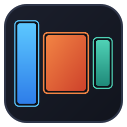
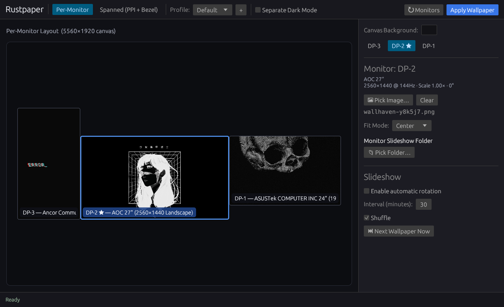
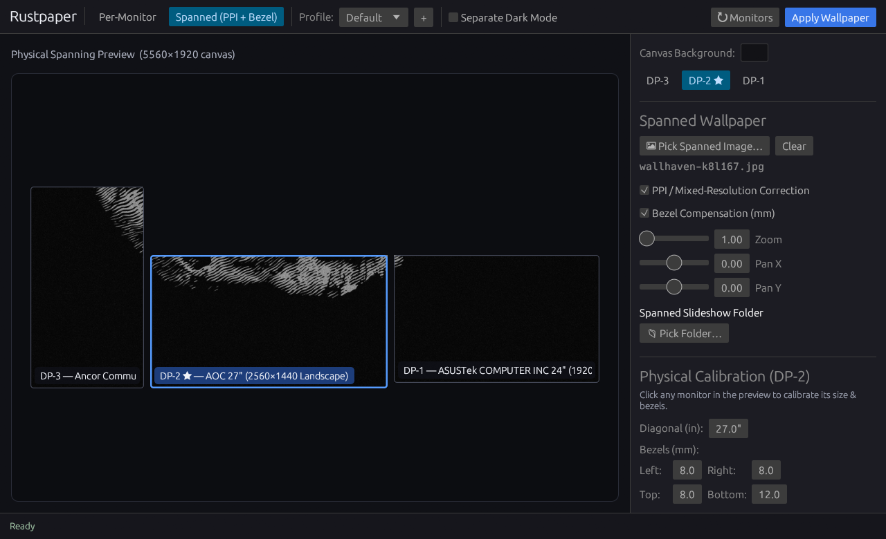

<p align="center">
  
</p>

<h1 align="center">Rustpaper</h1>

<p align="center">
  A fast, native Rust multi-monitor wallpaper manager for Linux (GNOME / Wayland),<br/>
  inspired by <strong>Superpaper</strong> and <strong>HydraPaper</strong>.
</p>

<p align="center">
  <a href="https://github.com/mjdelro/rustpaper/releases/latest">
    
  </a>
  
  
</p>

---

## Screenshots

### Per-Monitor Mode
Assign independent wallpapers to each display with live layout previews, drag-and-drop image support, and per-monitor fit/crop controls.



### Spanned Mode (PPI + Bezel Compensation)
Span a single wallpaper seamlessly across mixed-resolution, mixed-size, and mixed-orientation monitors with physical millimeter calibration.



---

## Features

- **Individual Wallpaper per Monitor** — Assign separate images to each display with `Center` (default), `Fill (Crop)` (plus focal `Crop X/Y` sliders), `Fit (Letterbox)`, and `Stretch` modes.
- **Physical Spanning (PPI + Bezel Compensation)** — Normalizes pixel density across mixed-resolution/size monitors (e.g. 23" portrait + 27" 1440p + 24" 1200p) with per-monitor diagonal inch calibration, bezel widths in millimeters, manual alignment nudge, zoom, and pan.
- **Live Interactive Layout Preview** — Reads your exact GNOME Mutter monitor geometry over D-Bus (`org.gnome.Mutter.DisplayConfig`) including rotations and HiDPI scale, with clickable monitor selection and drag-and-drop image assignment.
- **Separate GNOME Light & Dark Mode Wallpapers** — Configure independent wallpaper setups for `picture-uri` and `picture-uri-dark`.
- **Profiles & Slideshow Rotation** — Save/switch named profiles and rotate per-monitor or spanned folders automatically in-app or via the headless daemon.

---

## Installation

### AppImage (Recommended)

Download the latest `x86_64` AppImage from the [Releases](https://github.com/mjdelro/rustpaper/releases/latest) page:

```bash
chmod +x Rustpaper-0.1.0-x86_64.AppImage
./Rustpaper-0.1.0-x86_64.AppImage
```

### Build from Source

Requires Rust (`cargo`). No GTK `-devel` system packages are needed.

```bash
git clone https://github.com/mjdelro/rustpaper.git
cd rustpaper
cargo build --release
./target/release/rustpaper
```

---

## CLI Usage

```bash
# Launch the GUI
rustpaper

# Inspect detected monitors & stitched canvas geometry
rustpaper list-monitors

# Apply the active (or named) profile headlessly
rustpaper apply
rustpaper apply "Work"

# Advance slideshow to next image(s) and apply
rustpaper next

# Run headless slideshow daemon
rustpaper daemon
```

Configuration is stored at `~/.config/rustpaper/config.toml` and generated stitched wallpapers are cached in `~/.cache/rustpaper/`.
